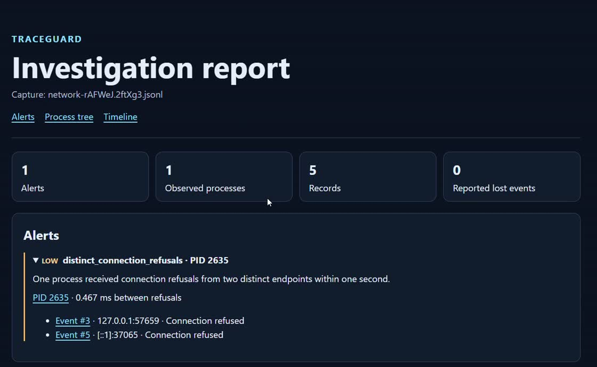

# TraceGuard

**TraceGuard is a Linux security telemetry lab.** It captures process and network events with eBPF, links them to the process that generated them, and turns a saved capture into an investigation report with evidence you can inspect.

[Demo video](https://github.com/Ori-Marom/traceguard/releases/download/v0.1.0/traceguard-demo.mp4) · [Release v0.1.0](https://github.com/Ori-Marom/traceguard/releases/tag/v0.1.0) · [Run the demo](docs/DEMO.md) · [Architecture](docs/ARCHITECTURE.md)



## What it does

- Captures scoped Linux process lifecycle events and blocking TCP connection outcomes in an IPv4 and IPv6 loopback lab.
- Preserves parent relationships and distinguishes reused PIDs using process start time. Captures are scoped to a host and boot.
- Replays versioned JSON Lines captures and flags two connection refusals to distinct endpoints by the same process within one second.
- Generates a self-contained HTML report with an alert, links to its original evidence, a process tree, and a timeline.

The rule is a low-severity signal for review. The lab was verified on Ubuntu under WSL2 with kernel 6.6.87.2 and bpftrace 0.20.2.

## Try it

From the repository root, generate a report from the included synthetic capture with Python 3.10 or later:

```bash
mkdir -p captures
python3 -m traceguard.report tests/fixtures/connection-refusals.jsonl \
  --output captures/investigation.html
```

Open `captures/investigation.html` and select an evidence link in **Alerts** to highlight the corresponding timeline row.

For a live run in Ubuntu under WSL2, follow the [setup guide](docs/SETUP.md), install bpftrace, and run:

```bash
sudo -v
python3 -m traceguard.demo
```

The command captures four loopback connections, checks for one alert, and prints the path to the resulting report. Captures and reports stay in the ignored `captures/` directory.

## Measured WSL2 run

**1,200 of 1,200 expected connection events were captured, with zero reported loss in the tested workload.** Three samples per mode ran 400 connection attempts each.

| Median | Baseline | Traced |
| --- | ---: | ---: |
| Wall time | 30.659 ms | 553.712 ms |
| CPU time | 29.215 ms | 42.643 ms |
| Reported peak RSS | 15,872 KiB | 15,872 KiB |

The traced run measures the full pipeline, including bpftrace startup and attachment, validation, and writing the capture. See the [benchmark method and per-run results](docs/DEMO.md#measured-wsl2-run).

## Project guide

- [Event format and replay](docs/EVENTS.md)
- [Process lifecycle lab](docs/LIFECYCLE-LAB.md) and [network lab](docs/NETWORK-LAB.md)
- [Detection rule](docs/DETECTION-LAB.md) and [investigation report](docs/INVESTIGATION-LAB.md)
- [Roadmap](docs/ROADMAP.md), [development journal](docs/DEVLOG.md), and [contribution workflow](CONTRIBUTING.md)

Run the tests with `python3 -m unittest discover -s tests -v`.

## Scope

TraceGuard is an educational Linux lab with scoped workloads. The lifecycle lab uses a single-threaded workload. The network lab verifies blocking loopback TCP, and the detector works on saved captures. WSL2 telemetry covers the Linux environment.
